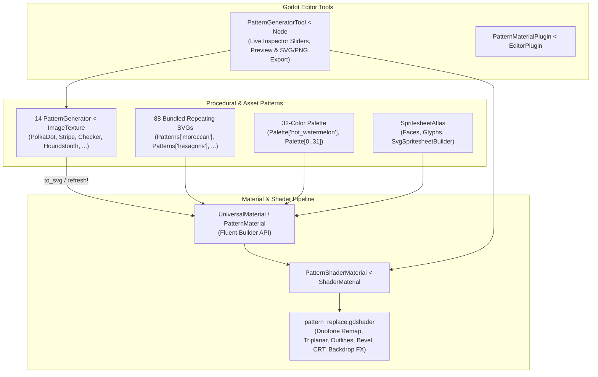

# Pattern Material for Lapis 🎨

<!-- carbon:badges -->
[](shard.yml)
[](https://crystal-lang.org)
[](LICENSE)
[](https://godotengine.org)
[](https://github.com/sol-vin/lapis)
[](https://github.com/sol-vin/pattern_material/actions/workflows/ci.yml)
[](https://sol-vin.github.io/pattern_material/)
<!-- /carbon:badges -->

**Pattern Material** (`pattern_material`) is a complete procedural and asset-driven pattern replacement material addon for **Lapis** (Godot Engine 4.8+ Crystal GDExtension bindings).

It combines a stylized **Universal Pattern Replace Shader** (`pattern_replace.gdshader`), **88 seamless repeating SVG patterns**, **14 parametric procedural `PatternGenerator < ImageTexture` classes**, a **32-color palette**, **spritesheet atlas builders**, and an interactive **`PatternGeneratorTool` editor node** so you can customize and bake textures visually or procedurally in code.

---

## Architecture Overview



---

## Features

- **Universal Pattern Replace Shader (`pattern_replace.gdshader`)**:
  - **Duotone Pattern Replacement**: Replaces target color channels (`replace_color` / `threshold`) with any repeating pattern texture tinted by `pattern_fg_color` and `pattern_bg_color`, plus optional `remap_unreplaced` color remapping.
  - **2D Cutout & 3D Surface Modes**: Supports `Flat2DCutout`, `Lit3DSurface`, `WorldTriplanar`, `MeshUV`, and `Cylindrical` projection modes, plus spritesheet `hframes`/`vframes`/`frame` indexing.
  - **Rich Stylization FX**: Animated boiling outlines (`Outer`, `Inner`, `Center`), 2D/3D bevel & rim lighting, Fresnel glow with pattern inversion, drop shadows, Bayer dithering, noise dissolve with glowing edges, and retro CRT scanline/glitch effects.
  - **Transparency & Screen-Space Backdrop FX**: Master opacity, alpha dither, screen-space refraction, pixelation, blur LOD, chromatic aberration, and 6 backdrop blend modes (`Normal`, `Add`, `Multiply`, `Screen`, `Subtract`, `DuotonePaletteMap`).
  - **Vertex FX**: Billboard modes (`Disabled`, `Standard`, `YBillboard`), vertex motion (`SurfaceWaves3D`, ` FlagWave`, `Pulse`), and PSX-style vertex snapping.
- **14 Procedural Pattern Generators (`PatternGenerator < ImageTexture`)**:
  - Mathematical, seamless repeating SVG generators rasterized at runtime or in the Godot Editor via `Image#load_svg_from_string`.
  - Every generator exposes typed `@[Export]` properties in the Godot Inspector and factory methods on `Patterns`.
- **Visual `PatternGeneratorTool` Node**:
  - Live `@[Tool]` node for tweaking procedural pattern parameters in the Godot Inspector with instant preview and one-click `.svg` export.
- **88 Seamless Repeating SVG Patterns (`Patterns`)**:
  - Curated library of 88 Hero Patterns SVGs (`moroccan`, `circuit_board`, `houndstooth`, `hexagons`, `topography`, `zig_zag`, etc.) with normalized key lookup (`Patterns["zig-zag"]`, `Patterns[0]`, `Patterns.texture("moroccan")`).
- **32-Color Palette (`Palette`)**:
  - Built-in 32-color Afterlife 98 palette (`addons/pattern_material/palette.pal` and `palette.tres`) accessible by index (`Palette[0]`) or name (`Palette["hot_watermelon"]`, `Palette["ice_aqua"]`, `Palette["deep_indigo"]`).
- **Spritesheet Atlases & Builders (`SpritesheetAtlas`, `Faces`, `Glyphs`, `SvgSpritesheetBuilder`)**:
  - Normalize duotone SVGs and pack icon directories into multi-cell SVG/tres `SpritesheetAtlas` resources.
- **4 Ready-to-Use Material Presets**:
  - `cutout_character.tres`, `sticker_glyph.tres`, `retro_hologram.tres`, and `glass_lens.tres` bundled in `addons/pattern_material/materials/`.

---

## Installation

Install `pattern_material` directly using the **Lapis CLI**:

```bash
# Install pre-compiled release addon from GitHub
lapis install addon github:sol-vin/pattern_material

# Or install from source and add to shard.yml
lapis install addon github:sol-vin/pattern_material --source --shard
```

Or add `pattern_material` to your project's `shard.yml`:

```yaml
dependencies:
  lapis:
    github: sol-vin/lapis
    branch: 4.8-beta1
  pattern_material:
    github: sol-vin/pattern_material
    branch: main
```

Then require it in your Crystal code:

```crystal
require "lapis"
require "pattern_material"
# Or when vendored in addons/:
require "../addons/pattern_material/src/pattern_material"
```

---

## Quickstart

### 1. Fluent `UniversalMaterial` (`PatternMaterial`) Builder

```crystal
umat = PatternMaterial.new
  .set_face("smile")
  .set_pattern("moroccan")
  .set_colors(
    fg: "hot_watermelon",
    bg: "ice_aqua",
    outline: "white",
    unreplaced: "deep_indigo"
  )
  .set_3d_surface(
    UniversalMaterial::ProjectionMode::WorldTriplanar,
    use_base_texture: true,
    tile_base_texture: true
  )
  .set_outline(enabled: true, width: 3.5, mode: UniversalMaterial::OutlineMode::Center, boil_amp: 0.2)
  .set_bevel(enabled: true, strength: 0.6)
  .set_fresnel(enabled: true, power: 2.5, invert_pattern: true)

# Apply to any MeshInstance3D, Sprite3D, or GeometryInstance3D
umat.apply_to(mesh_instance)
```

### 2. Using Procedural Pattern Generators

```crystal
# Create a staggered polka-dot pattern texture
dots = Patterns.polka_dots(
  dot_radius: 14.0,
  columns: 3,
  rows: 3,
  stagger: true,
  ring_thickness: 0.0,
  texture_size: 256
)

# Or angled crosshatched stripes
stripes = Patterns.stripes(
  stripe_count: 6,
  duty_cycle: 0.4,
  angle_degrees: 45.0,
  crosshatch: true
)

# Plug directly into UniversalMaterial
umat = PatternMaterial.new
  .set_generator(dots)
  .set_colors(fg: "electric_lemon", bg: "royal_plum", outline: "white")
```

---

## Procedural Pattern Generators Reference

All 14 generators inherit from `PatternGenerator < Godot::ImageTexture` and share common base parameters (`texture_size : Int64 = 256`, `invert : Bool = false`, `rotation_degrees : Float64 = 0.0`):

| Generator Class | `Patterns` Factory | Custom Arguments |
| :--- | :--- | :--- |
| `PolkaDotPattern` | `Patterns.polka_dots` | `dot_radius`, `columns`, `rows`, `stagger`, `ring_thickness` |
| `StripePattern` | `Patterns.stripes` | `stripe_count`, `duty_cycle`, `angle_degrees`, `crosshatch` |
| `CheckerPattern` | `Patterns.checkers` | `columns`, `rows`, `cell_inset`, `corner_radius` |
| `ZigZagPattern` | `Patterns.zig_zag` | `peaks`, `bands`, `amplitude`, `thickness` |
| `WavePattern` | `Patterns.waves` | `waves`, `bands`, `amplitude`, `thickness` |
| `RingPattern` | `Patterns.rings` | `ring_count`, `ring_width`, `max_radius`, `corner_overlays` |
| `HexagonPattern` | `Patterns.hexagons` | `columns`, `rows`, `hex_radius`, `stroke_width`, `flat_top` |
| `DiamondPattern` | `Patterns.diamonds` | `columns`, `rows`, `diamond_scale`, `hollow_stroke` |
| `CrossPattern` | `Patterns.crosses` | `columns`, `rows`, `arm_length`, `arm_thickness`, `diagonal_x` |
| `StarPattern` | `Patterns.stars` | `columns`, `rows`, `points`, `outer_radius`, `inner_radius`, `star_rotation` |
| `BrickPattern` | `Patterns.bricks` | `columns`, `rows`, `mortar_gap`, `row_offset`, `corner_radius` |
| `HoundstoothPattern` | `Patterns.houndstooth` | `subdivisions`, `tooth_slant` |
| `HalftonePattern` | `Patterns.halftone` | `columns`, `rows`, `min_radius`, `max_radius`, `radial_falloff`, `invert_falloff` |
| `CustomPatternGenerator` | `Patterns.custom` | `kind` (`PatternKind`), `columns`, `rows`, `primary_size`, `secondary_size`, `angle_degrees`, `stagger` |

---

## Documentation, Testing & Benchmarks

This repository uses **[Jasper](https://github.com/sol-vin/jasper)** for structured multi-track documentation and **[Carbon](https://github.com/sol-vin/carbon)** for automated commit-driven versioning and changelogs.

```bash
# Run headless Crystal specifications
crystal spec

# Compile Jasper YAML guides and generate HTML API docs
jasper build
lapis docs

# Run procedural SVG synthesis benchmarks
crystal run benchmarks/example_bench.cr -- 2000
crystal run benchmarks/compare_bench.cr -- 2000

# Build addon shared library and package redistributable zip
make package
```

---

## License

MIT License — see [LICENSE](LICENSE) for details.
